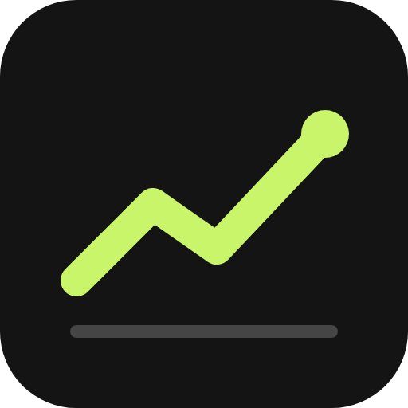
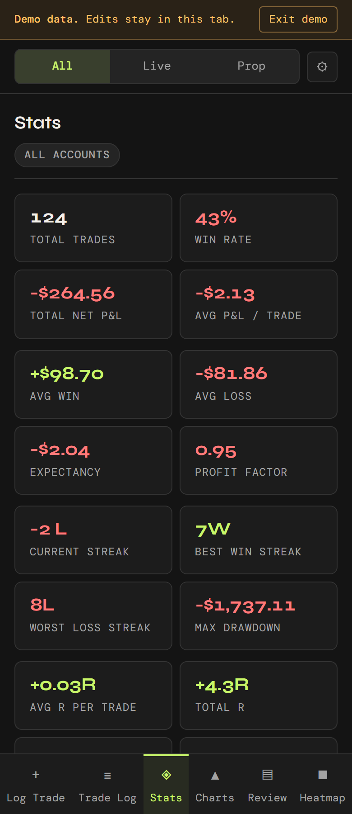
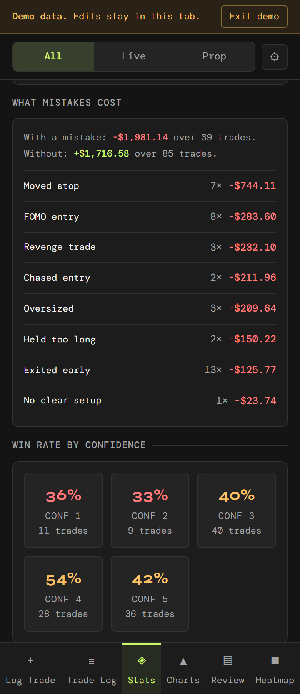
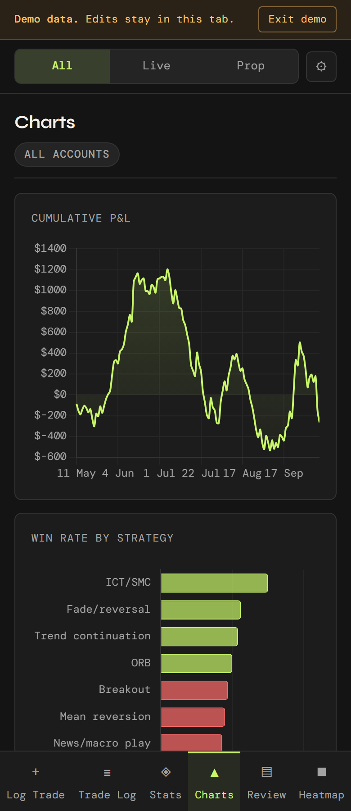
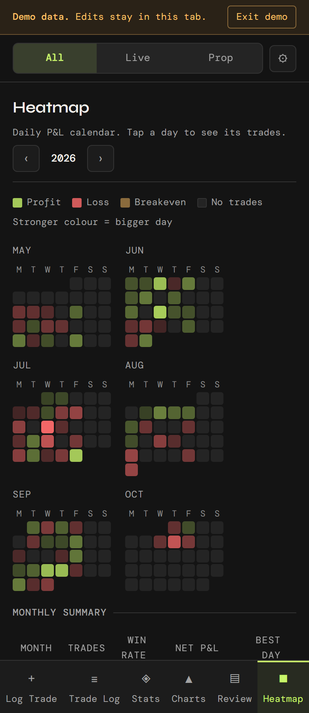

# Trade Journal

A futures trading journal for MES, MNQ, MGC and XAUUSD. Log each trade with its setup, what you felt and what you did wrong, and the R multiple works itself out as you type. The stats then show which setups hold up and what each mistake costs, so the inconsistency stops being a guess. Trades save to your own Google Sheet or this device, and it works offline. Installable as a PWA, with a demo mode.


<p align="center">
  
  
  
  
</p>
<p align="center"><sub>Stats, what mistakes cost, charts, and the daily P&L heatmap. Shown with the built-in demo data.</sub></p>

## At a glance

| | |
| --- | --- |
| **Live** | https://futuretracker.ethantam.dev |
| **Demo** | https://futuretracker.ethantam.dev/?demo |
| **Hosting** | Netlify site `futuretracker`: build `npm run build`, publish `dist` (set in `netlify.toml`) |
| **Data** | Your own Google Drive (Google sign-in, `drive.file` scope), a Google Sheet through your own Apps Script, or this device (`localStorage` / IndexedDB) |
| **Run locally** | `npm install && npm run dev`, then open http://localhost:5173 (add `?demo` for demo data) |
| **Source** | [gitlab.com/eatentam/futuretracker](https://gitlab.com/eatentam/futuretracker) |

Settings (names only): `VITE_GOOGLE_CLIENT_ID` (optional), the Google OAuth client ID. Without it the build uses the ID the live site has always used. Its authorised JavaScript origins in Google Cloud Console must include the live address.

> **About this source.** The original source was only on GitHub, and that account was suspended in October 2026. This code was rebuilt on 19 Oct 2026 from the live site's built files. The names, comments and file layout are new, but the behaviour is the same: the rebuilt app was checked against the live one in demo mode, screen by screen (139 screens, including charts pixel for pixel, logging a trade, and the first-run setup screen), with no differences.

## Features

- **Log a trade.** Instrument, account, direction, session and market conditions, with several entry legs at different prices. Average fill, P&L, risk and R work themselves out as you type.
- **Mistakes and confidence.** Tag what went wrong (moved stop, FOMO entry, revenge trade…) and how sure you were, and see what each one costs and how your win rate moves with confidence.
- **Stats.** Win rate, expectancy, profit factor, streaks and drawdown, broken down by strategy, session, weekday, instrument, long versus short, hold time and copy trader.
- **Charts, heatmap and review.** Cumulative P&L, win rate by strategy, a daily P&L calendar, and weekly and monthly summaries.
- **Live and prop accounts.** Switch between all accounts, live only or prop only.
- **Your storage.** Google Drive, your own Google Sheet through an Apps Script the setup screen walks you through, or just this device. Screenshots of a trade can go to Drive.
- **Offline.** New trades and edits wait in an outbox and go to your sheet when you're back online.
- **Demo mode.** `?demo` loads the same made-up trades every time (fixed seed); edits only last until the tab closes.

## Architecture

```
Browser (Vite build, service worker) ──▶ one of three stores, chosen at setup:
   ├─ Google Drive / Sheets   Google sign-in, drive.file scope
   ├─ Apps Script web app     your own sheet, your own script (src/apps-script.gs)
   └─ this device             localStorage / IndexedDB
Offline: writes queue in an outbox and replay when the connection is back.
```

| Path | Purpose |
| --- | --- |
| `index.html` | App shell: every screen's markup |
| `src/main.js` | Start-up, navigation between screens |
| `src/views/` | One file per screen: Log Trade, Trade Log, Stats, Charts, Heatmap, Review, the trade panel, and setup/settings |
| `src/trade.js` | Trade maths: average fills, P&L, risk, R, validation |
| `src/stats.js` | Win rate, expectancy, streaks, drawdown and the breakdowns |
| `src/stores/` | Where trades are kept: this browser, Apps Script, and the offline outbox |
| `src/google/` | Google sign-in, the Sheets backend, Drive screenshots |
| `src/demo.js` | The demo data (same trades every time, from a fixed seed) |
| `src/apps-script.gs` | The Apps Script the setup screen tells you to paste into your sheet |
| `src/style.css` | All styles |
| `sw.js` | Service worker. The build adds the list of files to cache and a version in front of it (see `vite.config.js`) |
| `public/` | Icons, manifest, privacy and terms pages, install screenshots |
| `netlify.toml` | Build settings and security headers |

There is no server of its own: trades go straight from the browser to the store you picked.

## Getting started

```sh
npm install
npm run dev      # http://localhost:5173, add ?demo for demo data
npm run build    # production build in dist/
```

Needs Node 22 (the version Netlify builds with). To deploy, connect the repository to Netlify; `netlify.toml` already sets the build command and publish directory.

## Legal

See the [privacy policy](public/privacy.html) and [terms](public/terms.html). Released under the [MIT License](LICENSE).
